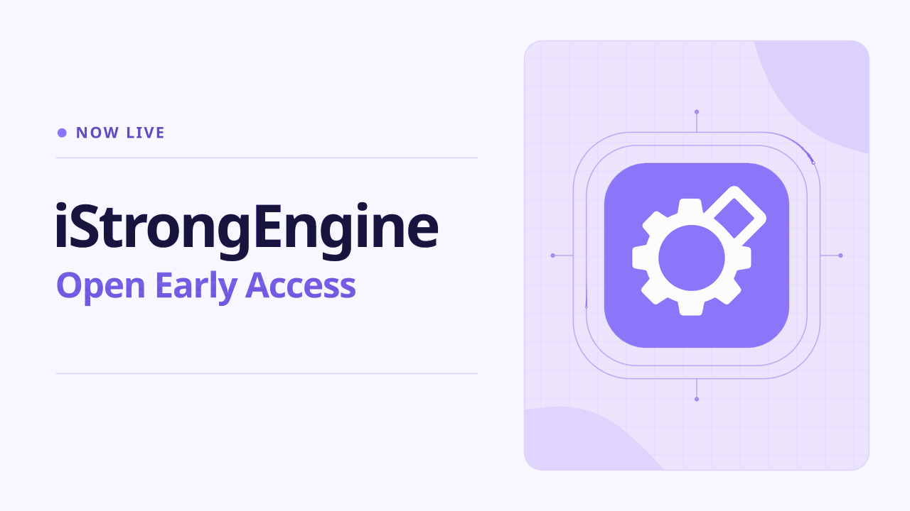
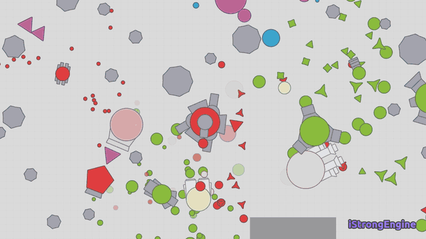
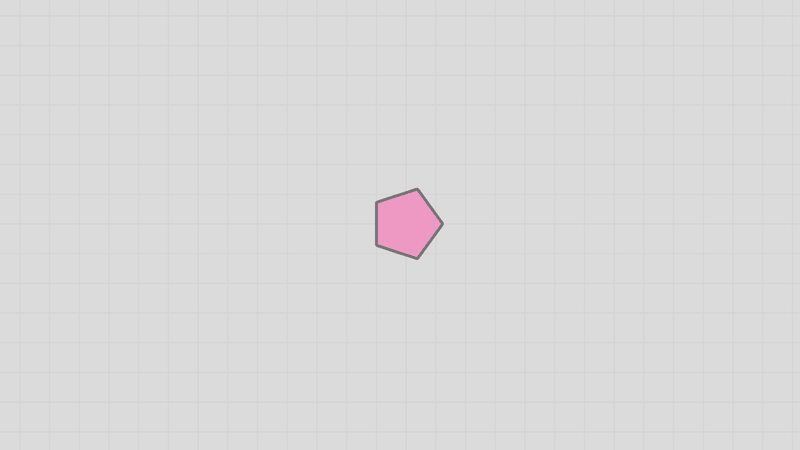
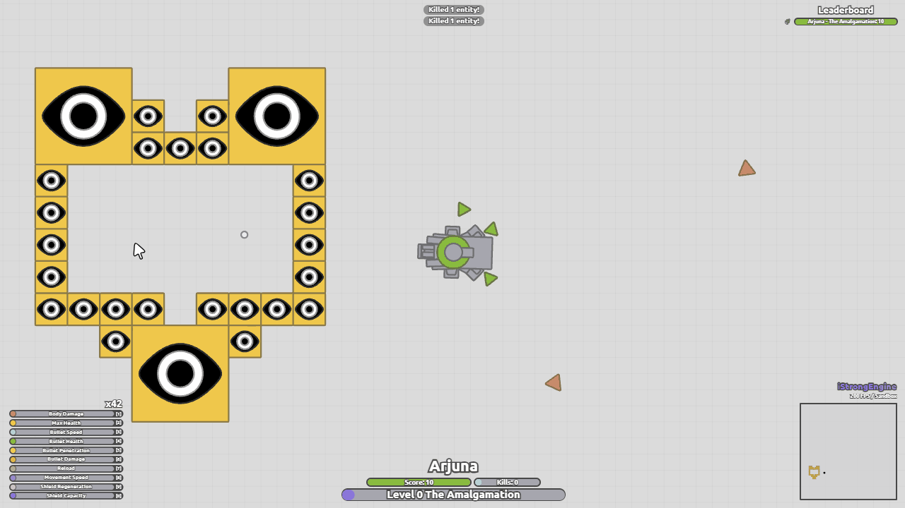
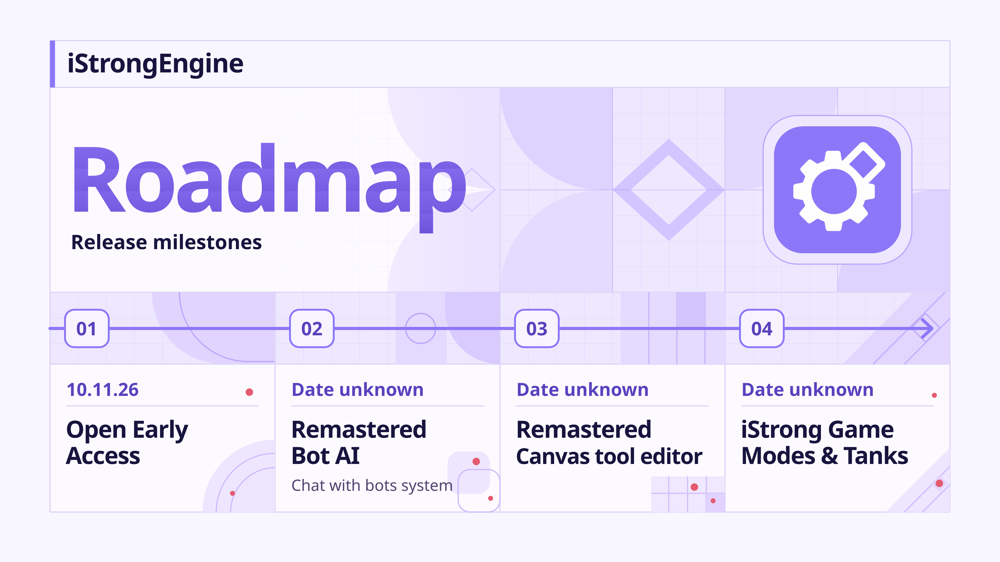

<p align="center">
  
</p>

<h1 align="center">iStrongEngine</h1>

<p align="center">
  A tank designer and sandbox for arras.io style tanks.<br>
  Build a tank, drop it into a match full of bots, and see how it plays.
</p>

<p align="center">
  <a href="https://istrong.pages.dev"><b>Play in your browser</b></a>
  &nbsp;|&nbsp;
  <a href="https://discord.gg/HTE9MTsmBm"><b>Discord</b></a>
</p>

<p align="center">
  I support arras.io and its devs. Go play their game at <a href="https://arras.io">arras.io</a>
</p>

## Play hundreds of game modes

FFA, teams, mazes, Growth, Arms Race, Siege, Soccer, Capture the Flag, Old Dreadnoughts and many more. Every mode comes with its own maps and settings.

<p align="center"></p>

## Design your own tanks

The Canvas tool lets you place turrets, shape the body and its layers, and set every stat. Any tank can also be fired as a projectile, so you can make guns that shoot tanks.

<p align="center"></p>

## Test them right away

Press Play and your tank drops into a sandbox with real physics and bots. The bots play by the same rules you do, they are just smarter about where to go.

<p align="center"></p>

## Make your own maps

The Map Designer and Map Events let you build arenas, place walls, portals and bases, and decide what happens during a match.

## Roadmap

<p align="center"></p>

## Run it yourself

You need Node.js 20 or newer.

```
npm install
npm run dev
```

For a production build:

```
npm run build
npm run preview
```

The source of every file is also inside the game itself: open the Source Code window from the top bar.

## License

Free to play, to learn from and to teach with. Not for commercial use. The full text is in [LICENSE](LICENSE), and the [Terms of Use](legal/TERMS-OF-USE.md) and [Privacy](legal/PRIVACY.md) pages are in the legal folder.

## Credits

The game rules and many tank numbers come from [Open Source Arras](https://github.com/open-source-arras/open-source-arras). The other libraries and fonts are listed in [public/THIRD-PARTY-NOTICES.txt](public/THIRD-PARTY-NOTICES.txt).

iStrongEngine is an independent project. It is not affiliated with, sponsored by, or endorsed by arras.io or its developers.

Made by Arjuna.
